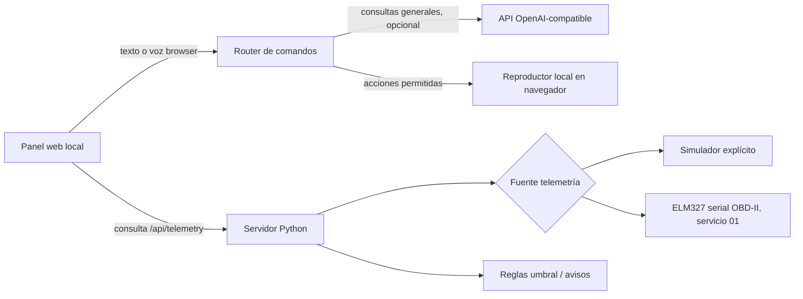

# Arquitectura y hoja de ruta

## Arquitectura v0.1

- La interfaz nunca envía instrucciones CAN, comandos OBD ni parámetros del vehículo.
- El servidor NO implementa escritura de ECU, conducción autónoma, apertura de puertas ni controles de clima.
- La IA recibe instantáneas informativas, sin herramientas para acceder al vehículo.
- La conectividad es local por defecto. Toda exposición externa requiere TLS, autenticación y una revisión de seguridad.
- No se recolectan ni almacenan mensajes, ubicación, VIN ni telemetría de forma persistente en v0.1.
- Las lecturas OBD-II estándar varían según modelo, año y adaptador.

## Roadmap

1. v0.1: demostración local y conector ELM327 serial de solo lectura; comandos tipados y voz del navegador.
2. v0.2: aplicación Android nativa (Kotlin) en pantallas Android compatibles, Bluetooth y permisos correctamente gestionados, micrófono y TTS nativos.
3. v0.3: integración Spotify App Remote con autorización individual y control de reproducción, y otros conectores multimedia.
4. v0.4: panel de configuración y detección de compatibilidad de adaptadores y métricas, modelos LLM locales/opcionales.
5. v1.0: distribución de APK firmados, instalador en Linux, actualización, diagnóstico del instalador y matriz de compatibilidad verificada.
6. Conformidad Android Auto/AAOS separada: solo categorías de apps admitidas, interfaces y permisos oficiales. No prometer disponibilidad general en pantallas OEM.

## Seguridad automotriz

No probar en marcha. Conectar o desconectar OBD solo siguiendo las indicaciones del fabricante.
El aparato no es un sistema de seguridad funcional ni tiene homologación; las alarmas son orientativas.
El término «batería» muestra voltaje detectado por el adaptador, no un test clínico del estado de batería.

## Próximas pruebas

- ELM327 genuino USB, sensor de RPM / temperatura, detección de PIDs soportados, reconexión.
- Pruebas unitarias con respuestas mal formadas e interrupción serial.
- Tests de seguridad de endpoints y velocidad de actualización.
- Prueba en laboratorio / coche parado de varios modelos y años.
