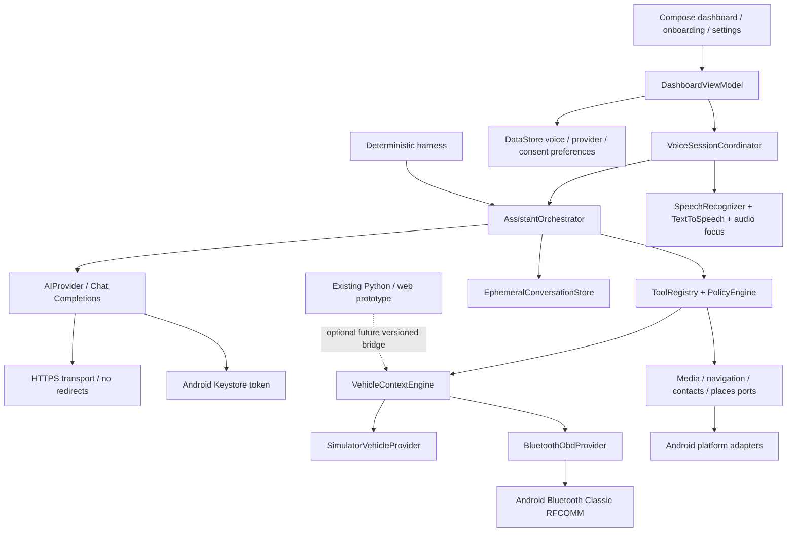

# Arquitectura V1
Tres módulos Gradle con implementación real: core JVM, testing JVM, app Android. Inyección manual,
MVVM, StateFlow, coroutines. Fakes antes de adaptadores. Sin Room ni servicios adicionales.

Les données externas son datos, nunca políticas. ToolRegistry valida argumentos cerrados y capacidades;
PolicyEngine no acepta autorizaciones del proveedor. Confirmación del marcador ligada al número pendiente,
con caducidad y cancelación. Se informa apertura del intent, no llamada/ruta completada.

TTL de métricas: 10 s, reloj inyectado, rechazar timestamps futuros. Simulación conserva etiqueta incluso
si su dato caduca. No calcular autonomía desde porcentaje. JSON v1 preparado; el proveedor HTTP opcional
solo recibe texto e historial consentidos, nunca el snapshot completo.
STT local si Android lo ofrece; fallback del motor del sistema requiere consentimiento explícito por posible
uso de red. Solo voces TTS locales es-ES instaladas. Reconocimiento de una sesión, sin wake word permanente.

Flujo: usuario → STT → IntentResolver → herramienta local o AIProvider → propuesta tipada → PolicyEngine →
CapabilityRegistry → ToolRegistry → resultado real → texto visible → TTS si hay voz. El texto libre del modelo
no entra en el registro de herramientas. Las llamadas y contactos solo nacen de un comando directo con
confirmación local. `AIResponse` separa texto, propuesta, indisponibilidad y respuesta inválida.
