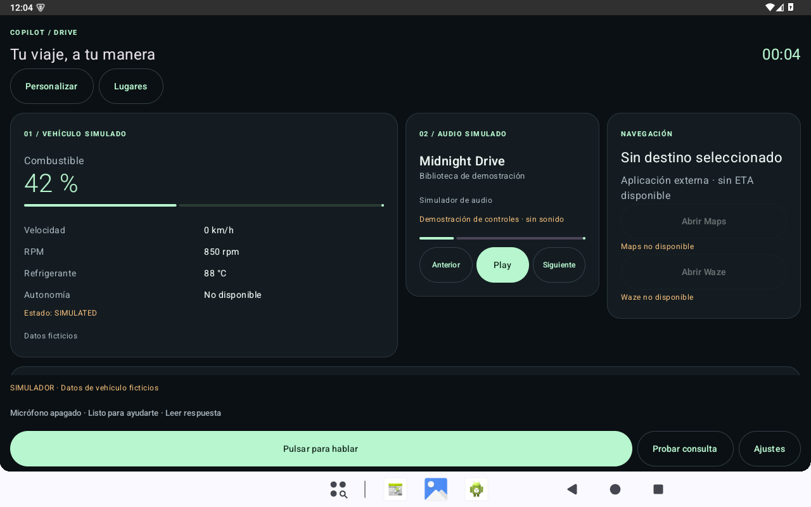
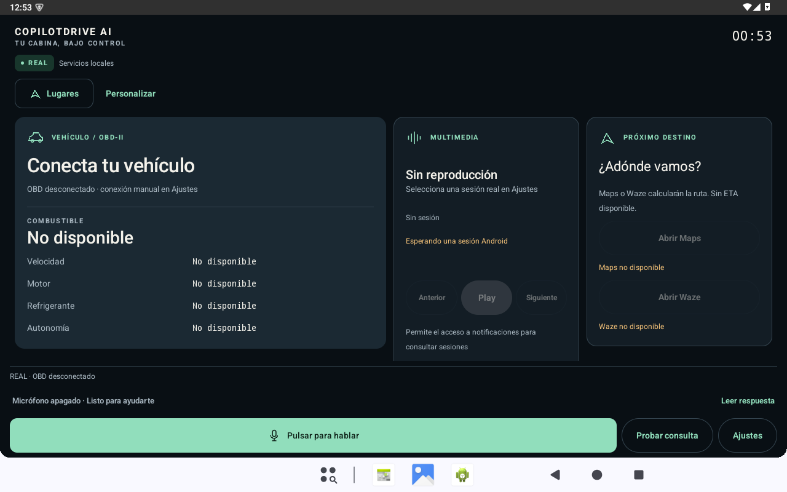

# COPILOTDRIVE AI — Sprint 11

2026-10-21 · Europe/Madrid. Implementación nativa y candidata debug preparadas.
**REAL predeterminado, DEMO explícito, sin cifras vehiculares ficticias en REAL.**
Pruebas funcionales aprobadas; instalación/apertura en HONOR comprobadas por ADB.
Validación humana de este APK y rendimiento controlado pendientes.

## Estado canónico y preservación

El checkout inicial estaba limpio en `feat/sprint10-1-physical-validation`, `7df8832`.
`git ls-remote` y fetch mostraron que `origin/main` ya incluía Sprint10.1 por PR #11,
merge `be3344c8de1c2d01a1d7b6a382e002d4cdb88a2d`; el main local aún apuntaba a Sprint9.
Sprint10 `de7c4c8` es ancestro de Sprint10.1 y de ese merge. Sprint10.1 está publicado;
Sprint10 no tenía rama remota separada, pero sus commits están incluidos en main.
Se creó `feat/sprint11-real-mode-premium-ui` desde el merge canónico. No rebase,
mezcla de historias, pérdida de commits ni alteración del acta física Sprint10.1.
Push autorizado posteriormente por el usuario; sin PR remota, merge ni release.

## A. Skills investigadas y usadas

[Auditoría completa](UI_SKILLS_RESEARCH.md): UI/UX Pro Max MIT, revisión
`56ea9cf174ed86786187daa9de0e6247cb0747e4`, instalada como copia revisada en Codex;
Mobile Android Design MIT y Compose Component Design Apache-2.0, instaladas mediante
skill-installer; Frontend Design Apache-2.0 ya disponible, aplicada como guía estética.
Se revisó Material 3 oficial. Sin npx ni scripts de terceros ejecutados a ciegas,
sin dependencias de UI nuevas, sin migración web ni cambios de compileSdk 35/minSdk 26.

## B. Comparativa visual auténtica

| UI previa instalada, DEMO por defecto | Candidata Sprint11, REAL sin OBD |
|---|---|
|  |  |

La captura previa es del APK que estaba instalado en el emulador, hash `c23f86e1b7dc7f3dea05d9af6e41374ef2b79a58d1227b302b7ca1ab12400ea2`;
no se equipara al APK físico archivado. Ambas vistas son 1280×800; el cambio de fuente
es intencionado. Para comparar la estética con datos ficticios, ver
[DEMO explícito nuevo](assets/sprint11/sprint11-dashboard-demo.png).

## C. Design system adoptado

«Instrumentación serena»: grafito `#090F14`, panel `#131D25`, superficie elevada
`#1B2933`, voz `#102A25`, menta `#91DEBC` y blanco cálido `#F4F2EB`.
Tipografía Android escalable, números monoespaciados, controles de 48–60 dp,
componentes Material 3 y símbolos Canvas originales. Tres direcciones evaluadas:
instrumentación, atlas de viaje y estudio editorial. Se eligió claridad vehicular
y coste bajo de dibujo. [Tokens y criterios](COPILOT_DESIGN_SYSTEM.md).
Contraste calculado de texto secundario/paneles: mínimo 7,01:1; no equivale a una
certificación completa de accesibilidad ni sustituye TalkBack humano.

## D. Pantallas transformadas

Dashboard con marca/fuente/modo y hero vehicular; Jarvis con firma de voz y respuesta
completa; ocho widgets con variantes; Ajustes en ocho secciones; Device Lab, Places,
destinos externos y onboarding REAL. Se conservan registro cerrado, presets, codec
y DataStore de layout v1. No hay mapa, canción, carátula ni ETA inventados en REAL.
Cabecera horizontal compacta y combustible adelantado en la variante compacta.

## E. Arquitectura REAL / DEMO

[Contrato y auditoría de fuentes](REAL_MODE_ARCHITECTURE.md). OperationMode se
persiste por separado del estado OBD. Nueva instalación REAL; preferencia antigua
sin modo pasa a REAL con aviso reconocible, manteniendo voz/consentimientos/layout.
Una elección guardada se conserva. El default simulado anterior no era una elección
persistida recuperable. No fallback silencioso. Cambiar de modo cancela audio,
cierra OBD y borra respuestas/resultados de la fuente anterior; cancelar voz de forma
normal continúa conservando la respuesta escrita.

Sin OBD, Jarvis responde «No puedo consultar el combustible porque todavía no estoy
conectado al vehículo». Diferencia UNSUPPORTED, UNAVAILABLE y STALE, sin sustituirlos
por números. El schema de telemetría v1 no cambia. Fakes y prototipo Python/web
se conservan; este último no es una fuente empaquetada en el APK.

## F. Integraciones reales

| Integración | Implementada | Requisito o prueba pendiente |
|---|---|---|
| Jarvis local | Herramientas autorizadas y respuesta escrita sin clave | Acústica del APK nuevo en HONOR |
| STT/TTS Android | Pipeline previo conservado, PTT, foco y cancelación | Motor/datos instalados y permiso; sin escucha de fondo |
| ELM327 | Selección, confirmación, inicialización, PIDs y cierre | Adaptador/Juke reales; no se garantiza ningún PID |
| MediaSession | Sesión real y controles soportados, vacío sin sesión | Reproductor físico y consentimiento de sesiones |
| Maps/Waze | Disponibilidad y apertura de intent con destino | App instalada; apertura no confirma ruta ni ETA |
| Google Places | SDK, coarse location y consentimiento separado | Clave restringida/cuota; sin clave NOT_CONFIGURED |
| IA externa | Endpoint/modelo/Keystore/HTTPS opt-in | Credencial y proveedor reales; sin telemetría/contactos/ubicación |
| Contactos | Permiso local, confirmación y ACTION_DIAL | Interoperabilidad física; nunca llamada automática |

[Matriz detallada](REAL_INTEGRATIONS_MATRIX.md). No se realizaron solicitudes facturables.

## G. Tests y resultados

| Capa | Resultado final |
|---|---|
| Python | 56/56 |
| Kotlin core | 51/51 |
| Escenarios JVM/testing | 77/77 |
| Android unit | 6/6 |
| Instrumentación API26 | 42/42 |
| Instrumentación API30 | 42/42 |
| Instrumentación API35 | 42/42 |
| Lint debug | 0 errores, 12 avisos existentes |
| APK debug y AndroidTest | BUILD SUCCESSFUL |
| Reglas de repositorio / diff | Aprobadas |

**232 casos distintos**; 126 ejecuciones instrumentadas finales sobre 42 casos.
Los APKs y listeners se verificaron antes/después; API30/35 registran 0 crash/ANR
nuevos en exit-info acotado. API26 no soporta esos contadores y no se inventa cero.
Los tests no certifican audio, radio Bluetooth, GPS, OEM, vehículo ni TalkBack reales.

Baseline: Python 56 ejecutadas; tareas Gradle del código base exitosas, mayormente
UP-TO-DATE. No se presentan resultados cacheados como nuevas ejecuciones.
Se conservan el primer fallo JVM de texto caducado, un error de lint del fixture
y la primera campaña API35 con 3 fallos/42, corregidos sin eliminar tests.
La iteración visual posterior corrigió contraste del hero, prefijo de micrófono,
estabilización de captura, valor principal en 800×480 y acción «Leer respuesta»
siempre separada del texto largo con fuente ampliada. Ver [auditoría](UI_VISUAL_AUDIT.md).

Comandos: `python -m unittest discover -s tests -v`, `python scripts/check_repository.py`,
Gradle `:core:test :testing:test :app:testDebugUnitTest :app:lintDebug :app:assembleDebug
:app:assembleDebugAndroidTest`, y `scripts/compatibility_android.py` sobre AVDs
`CopilotDrive_Sprint9_API26/30/35` con opt-in explícito a fixtures desechables.
Se redujo Gradle a heap 768 MiB, un worker y compilador Kotlin in-process para
separar las compilaciones de los emuladores. Logs locales en `artifacts/sprint11`.

## H. Capturas del APK

- [REAL vertical 1080×2412](assets/sprint11/portrait-1080x2412.png)
- [REAL horizontal 800×480](assets/sprint11/landscape-800x480.png)
- [DEMO explícito](assets/sprint11/sprint11-dashboard-demo.png)
- [Jarvis listo](assets/sprint11/sprint11-jarvis-idle.png) / [respuesta escrita](assets/sprint11/sprint11-jarvis-response.png)
- [Audio sin sesión](assets/sprint11/sprint11-media-empty.png) / [fixture TEST/DEMO](assets/sprint11/sprint11-media-test-fixture.png)
- [Ajustes](assets/sprint11/sprint11-settings.png), [Device Lab](assets/sprint11/sprint11-device-lab.png), [Places](assets/sprint11/sprint11-places.png)
- [1024×600](assets/sprint11/landscape-1024x600.png), [1280×720](assets/sprint11/landscape-1280x720.png), [horizontal de móvil](assets/sprint11/landscape-2412x1080.png), [fuente 150 %](assets/sprint11/portrait-font150.png)

Capturas sin montaje ni generación; manifiesto con hashes en `assets/sprint11/capture-manifest.json`.
La matriz usa densidad explícita: 420 dpi en móvil emulado, 160 en cabina/tablet.
No se afirma que 420 dpi sea la densidad real del HONOR. Tamaño/densidad/fuente/rotación
restaurados; fuente hasta 200 % adicionalmente ejercitada por tests adaptativos.

## I. APK debug y verificación

Archivo local: `artifacts/sprint11/CopilotDrive-AI-sprint11-debug.apk`.
Paquete `ai.copilotdrive.app`, **0.11.0-debug / versionCode 2**, min 26, target 35,
21,907,413 bytes. APK Android convencional, sin release; instalado en HONOR según sección L.

SHA-256:
```text
37adf5ee0bcc7668e7aebb529feb26feb8b28bca155c48f5456feb6ffd56f606
```

Certificado SHA-256:
```text
ad561b54e005e27e4ca2873963ee7f6c34c4e246feb9ea76aa4cc2e2eb476a8a
```

Firma debug verificada y coincidente con el APK Sprint10 archivado
`fcec5256a0c0911eefe22ca2492db45a9374bcb45ace81ba9269ae664b7e643c` (versionCode 1). Permisos fusionados revisados:
coarse-only, sin FINE/BACKGROUND_LOCATION, sin permisos de llamada directa o privilegios.
Test APK SHA-256: `a14dc75289db8d88791aadd0b3addc0d42c3a8a3a0cf5d64592efbd7024bbda4`. `SHA256SUMS.txt` y preflight JSON junto a los APKs.

## J. Rendimiento y limitaciones

La guarda del host devolvió HOST_PHYSICAL_MEMORY_PRESSURE, con 286–351 MiB libres
y paging variable durante la campaña. No se repitió una campaña de jank/Perfetto
en esas condiciones, ni se afirma ausencia de regresión o mejora de fluidez.
Se conservaron pruebas funcionales/capturas; no se infiere una fuga de memoria.
No se añadieron bucles de animación, dependencias UI o imágenes pesadas.
TTS ausente/no inicializado en emulador mantiene la respuesta escrita; no demuestra
audibilidad del APK nuevo. TalkBack humano, insets/IME OEM y hardware siguen pendientes.

## K. Cambios y commits locales

Código y pruebas: `67852e0f2f6e952f576a3c443b337d65226ae562`
(`feat: default to real sources and redesign the native automotive cockpit`).
Legibilidad de la respuesta ampliada: `2d4a426` y `7463623a7bfba4ce58ceedda0b541e35783e5a72`.
La candidata y sus capturas corresponden al último de esos commits.
La documentación y capturas sanitizadas se guardan en un commit local posterior.
APKs, SDKs, secretos, logs y trazas permanecen ignorados. Las ramas anteriores y
la evidencia física Sprint10.1 se conservaron. El emulador original recuperó el
APK y ambos hashes DataStore exactamente iguales a los registrados antes del trabajo.

## L. Guía HONOR 400 Lite

El 2026-10-21 el usuario solicitó instalar y abrir la app en su móvil. El preflight
pasivo en HONOR 400 Lite / ABR-NX1, Android 16/API36, confirmó firma coincidente y
compatibilidad. Actualización versionCode 1 → 2 mediante `install -r`: Success.
El SHA-256 del base.apk instalado coincide exactamente con la candidata de sección I.
Los hashes de ambos DataStore (preferencias y layout) permanecieron iguales después
de instalar y antes del primer arranque. MainActivity arrancó con Status OK y ADB
confirmó `topResumedActivity` del paquete. No uninstall, downgrade ni clear-data.
Acta y logs locales ignorados en `artifacts/sprint11/honor-install-launch.json`,
`honor-preflight.json`, `honor-datastore-*-install.txt` y `honor-launch.txt`.
[Procedimiento y pruebas pendientes](NEXT_STEPS.md).

Probar UI, voz real, gasolina sin OBD, DEMO explícito, persistencia, regreso a REAL,
cancelación/fondo y legibilidad vertical/horizontal. Registrar intentos y observación
humana del APK exacto. La instalación y apertura no califican acústica, OBD o UI OEM.

## M. Pendientes externos

Google Places: clave restringida, proyecto/cuota de pruebas y consentimiento.
OBD: ELM327 emparejado, permiso y lectura autorizada con coche detenido; soporte
real de PIDs Juke por observación, sin ECU writes/DTC/CAN libre.
IA: endpoint/modelo/credencial de prueba y opt-in; funciones locales no requieren clave.
Media/Maps/Waze/contactos: validación del efecto real y revocación de permisos.

## N. Próximo sprint

Sprint12: piloto físico de esta candidata, interoperabilidad y hardware OBD;
proveedores reales consentidos y rendimiento emparejado con host estable. Una futura
integración Android Auto se investigaría por separado según categorías permitidas,
sin trasladar arbitrariamente esta Activity a Android Auto.

## O. Pasos para PR

Revisar commits, diff contra `origin/main`, informes y capturas; el usuario autorizó
`git push -u origin feat/sprint11-real-mode-premium-ui`. Después abrir comparación
main...rama y esperar CI Android/Tests. Título y descripción sugeridos en
[NEXT_STEPS.md](NEXT_STEPS.md). Sin PR remota, merge ni release.
